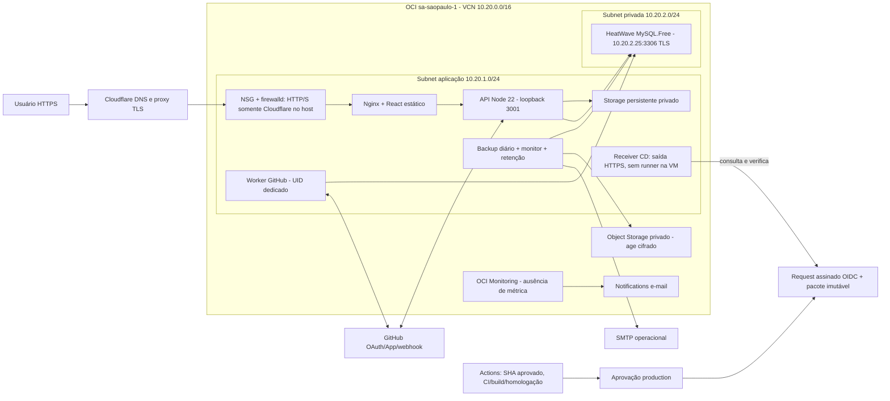

# ADR-018 — Topologia OCI real e CD da instalação limpa

Data: 21/10/2026. Decisão operacional solicitada pelo responsável pelo projeto.
Escopo: infraestrutura e publicação controlada; nenhuma funcionalidade nova.

## Contexto e decisão

A instalação limpa está online em `https://traceflow.dev`, aplicação imutável
`9bc3dad199566afc6fa43d67abba400665d843ea`, banco `traceflow_live`, serviços
`traceflow-live-api` e `traceflow-live-worker`. O estado/protocolo da implantação
abandonada não governa esta instalação e não será reutilizado.

A referência de duas VMs foi substituída pela topologia efetivamente disponível:
uma VM ARM64 de aplicação e **MySQL HeatWave gerenciado, privado**. Não existe uma
segunda VM MySQL nesta topologia. O serviço gerenciado fornece o endpoint privado,
TLS e manutenção do motor; isso reduz administração de SO/banco, sem transformar
seu backup nativo em prova automática de restore da aplicação. A S2-10 já provou
backup cifrado de banco/arquivos/configuração e restore isolado.

## Inventário e limites comprovados

| Componente | Configuração real |
| --- | --- |
| Região | Brazil East / `sa-saopaulo-1`, home region; AD `JEpm:SA-SAOPAULO-1-AD-1` |
| VM | `traceflow-app`, VM.Standard.A1.Flex, 2 OCPUs/12GiB; Oracle Linux 9.8 aarch64; IP privado 10.20.1.184 |
| Runtime | Node 22.23.2, Prisma 6.12.0; Nginx; frontend React/Vite; API e worker separados |
| Banco | HeatWave gerenciado shape **MySQL.Free**, motor 26.7.0-cloud, 61 tabelas/68 migrations/116 FKs na baseline |
| Acesso DB | Endpoint privado; subnet proíbe IP público; NSG recebe TCP3306 somente do NSG da aplicação; TLS VERIFY_IDENTITY e contas por origem |
| Ingress | SSH de dois /32 administrativos existentes; Nginx na VM; 80/443 filtrados pelos CIDRs oficiais Cloudflare; API somente loopback |
| Domínio/TLS | `traceflow.dev`, Cloudflare proxy/DNS existentes, TLS público normal, Origin CA e Full strict, HSTS/CSP/origens HTTPS; sem mudança DNS nesta entrega |
| GitHub App | App existente `TraceFlow TCC`, instalação autorizada existente; OAuth/App independentes; permissões/chaves preservadas |
| Webhook | `https://traceflow.dev/api/webhooks/github-app` |
| OAuth | `https://traceflow.dev/api/auth/github/callback` |
| Setup callback | `https://traceflow.dev/api/github-app/callback` |
| Segredos | Env root 0600 em /etc/traceflow-live, encrypted credential systemd para backup SELECT-only, chave privada de recuperação fora da VM; nenhum segredo no GitHub CD |
| Dados | `traceflow_live`; storage /var/lib/traceflow-live/test-evidence UID privado; legado isolado, nunca reutilizado como homologação |
| Backup | Bucket privado existente traceflow-production-recovery, prefixo production-live-v1/, age cifrado antes do envio, instance principal com escopo de VM/prefixo |
| Operação | Backup diário 03h BRT, retenção 02:30 BRT, monitor a cada minuto; SMTP e ONS confirmados; RPO alvo 24h, RTO planejado 4h (integral não medido) |
| CD | Runner hospedado ARM64 + Oracle Linux 9; request assinado GitHub OIDC após aprovação; pull outbound na VM, sem abertura SSH ou credencial Oracle/DB no runner |

A VM observada cabe nominalmente no limite público Always Free A1 vigente de 1.500 OCPU-h e 9.000 GiB-h
mensais (equivalentes a 2 OCPUs/12GiB contínuos). O DB usa a shape MySQL.Free, reconhecida pela documentação oficial como
Always Free. O campo `is-free-tier` não foi fornecido pela consulta usada; não
fabricar esse booleano. O console mostrou trial com R$0 utilizados e créditos
restantes. Não se infere garantia de capacidade regional, gratuidade global ou
custo futuro apenas desses sinais. Object Storage, Monitoring e Notifications
reutilizam recursos/franquias existentes. Nenhum recurso pago adicional é necessário
para esta CD em repositório público; revisar franquias/consumo antes de expansão.

## IaC e separação dos ambientes

`deploy/iac/oci` contém provider fixado, inventário somente leitura e modelo
parametrizado de VCN/subnets/NSGs/VM ARM64/MySQL/bucket/IAM. Gerenciamento de recursos
fica desativado por padrão. Não recriar ou aplicar mudanças para preencher um
checklist. State e tfvars reais são privados, nunca versionados; acesso por sessão
OCI legítima. IaC de recursos existentes só poderá assumir gerenciamento após
importação com revisão e plano sem substituições. A validação/plano executados e
as limitações efetivas constarão do relatório final, sem presumir sucesso.

Homologação reproduzível na própria Actions: runner descartável, MySQL separado
`traceflow_cd_test`, storage temporário, conta/dados sintéticos, sem credenciais
produtivas e sem acesso privado ao HeatWave. Aplica a cadeia de migrations e inicia
API/worker para readiness/heartbeat. Não é outra VM OCI permanente nem um ambiente
público GitHub OAuth completo. Os fluxos OAuth de produção não afetados não serão
repetidos. Defeitos de promoção são ensaiados separadamente por HTTP loopback.

## Consequências

A CD publica o SHA aprovado mesmo com código funcional mais novo na main. Somente
componentes operacionais entram na main nesta entrega. Push na main não publica.
É necessária aprovação production e confiança root na revisão do workflow. Nenhum
runner público executa código arbitrário dentro da VM. O prazo de consulta é até
cinco minutos, evitando credenciais estáticas e novas portas/recursos de rede.

Rollback altera aplicação/ingress quando schema idêntico, sem restore destrutivo.
Migrations novas em produção permanecem bloqueadas até aprovação e compatibilidade
operacional/backup; ver o runbook. Não afirmar que essa parcela já está concluída
apenas porque `prisma migrate deploy` passou no banco descartável.

Fontes primárias: [Always Free](https://docs.oracle.com/en-us/iaas/Content/FreeTier/freetier_topic-Always_Free_Resources.htm),
[MySQL Free](https://docs.oracle.com/en-us/iaas/mysql-database/doc/creating-always-free-db-system.html),
[shapes MySQL](https://docs.oracle.com/en-us/iaas/mysql-database/doc/supported-shapes.html),
[atestação](https://docs.github.com/en/actions/how-tos/secure-your-work/use-artifact-attestations/use-artifact-attestations).
